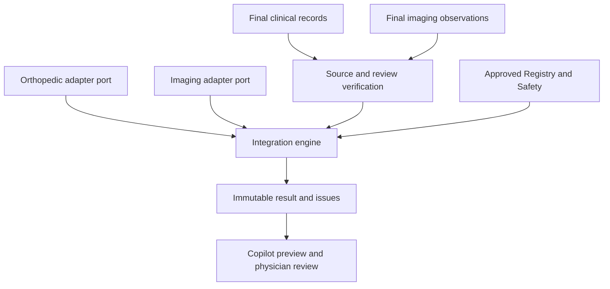

# Clinical Intelligence Integration Engine — initial implementation

The new experimental sidecar composes finalized clinical records, finalized
structured imaging observations, selected approved knowledge and the existing
Physician Copilot into an immutable, reviewable artifact. It provides **no
diagnosis, treatment recommendation, treatment execution or clinical clearance**.

## Verified starting point

Inspected main `bc6fb3f15825d6eaccaa45503ad61a432baf1c5b` (2026-10-19).
Its Backend CI run
[39264068377](https://github.com/kianariai-alt/4B-MOS/actions/runs/39264068377)
completed successfully. Targeted baseline: 74 existing tests passed.

| Existing capability | Verified implementation / integration point |
| --- | --- |
| Patient and Visit | Existing UUID-based tables and visit locking |
| Structured Clinical Context | `ClinicalContextService.get_current_context`, current final intake/reports; typed observations, correction/error lifecycle and digests |
| Medical Knowledge Registry | `MedicalKnowledgeService.get`, content verification, source records, independent review, validity dates and supersession |
| Clinical Safety | Active governed rules, immutable evaluations, context/rule-set digests and review inbox |
| Physician Copilot | Read-only manifest over context, safety/reviews, evidence briefs and treatment outcomes |
| Similar-patient roadmap | Separate existing descriptive options workflow; not invoked to choose a treatment here |
| Physician decisions | Existing immutable treatment-decision service; not replaced by summary approval |
| Audit | Existing audit repository and visit-locked atomic write protocol |
| Migrations | Existing single Alembic head `a1d4e7f0b386` before this change |

Open PR at inspection: [#43](https://github.com/kianariai-alt/4B-MOS/pull/43),
`feature/dual-knowledge-cores-foundation`: read-only knowledge-pack manifest,
not specialist inference or imaging ingress. It changes the shared API router
but has no migration. This change does not merge or edit its specialized files.
The three requested feature branches were absent; this work uses only
`feature/clinical-intelligence-integration` from inspected main. No other branch
history is overwritten.

No existing DICOM ingress, validated imaging model, registered specialist core,
LangGraph/pgmpy/GoRules runtime or model-version registry was found in main.
Do not interpret project plans as installed/validated capabilities.

## Architecture and ownership



- `schemas/clinical_integration.py`: shared contract 1.0.0.
- `services/clinical_integration/ports.py`: read-only `CoreAdapter` protocol.
- `adapters.py`: current-record passthrough adapters and Registry lookup.
- `engine.py`: validated producer boundaries, explicit missing/error states,
  confirmed versus model findings, narrow discordance checks and provenance.
- `service.py`: visit lock, immutable persistence, idempotency, freshness,
  independent physician review and existing audit integration.
- `models/clinical_integration.py`: append-only run/review ORM models.
- `api/routes/clinical_integration.py`: role-gated experimental APIs.

The specialist workstreams own their knowledge, model validation and inference.
This implementation consumes their eventual versioned outputs through ports;
the initial adapters merely read already finalized 4B-MOS data. They do not
reimplement either core. Production model inference must not run while holding
the visit lock: adapters should read already completed results with bounded I/O.

## Orchestrator decision

Use a small synchronous state machine for this phase. Every invocation consists
of read-only collection, validation and one atomic persisted snapshot. It then
waits durably for an independent review. There are no external side effects,
background jobs, graph branches or inference tasks to checkpoint mid-flight.
An interrupted pre-commit invocation may safely replay the same request key;
a committed invocation returns the original artifact. Unavailable cores produce
a persisted blocked result; a new request key performs a new collection attempt.

LangGraph provides checkpointed interrupts and resumable execution; its
[official interrupt documentation](https://docs.langchain.com/oss/python/langgraph/interrupts)
was reviewed. Additional checkpoint storage, graph lifecycle and replay
semantics are not justified for the present bounded flow. Re-evaluate when
multi-stage asynchronous processing, separate worker recovery or several human
review steps must resume within one run. Retain this data contract and immutable
artifacts if that orchestration implementation changes.

States in the saved result are `blocked` and `awaiting_physician_review`. Reviews
are append-only events alongside the result; they never mutate its state into
clinical approval. There is deliberately no `cleared_for_treatment` state.

## APIs

All routes are under `/api/v1`, require authentication and are hidden behind
`CLINICAL_INTEGRATION_ENABLED=false` by default.

| Method / path | Purpose | Role |
| --- | --- | --- |
| GET `/clinical-integration/contract` | Producer/result JSON Schemas | admin, physician |
| POST `/visits/{visit_id}/clinical-integration/runs` | Capture an immutable combined artifact; guarded context hash, request key, selected knowledge IDs | admin, physician |
| GET `/visits/{visit_id}/clinical-integration/runs/{run_id}` | Saved artifact, live freshness, review history | admin, physician |
| POST `/visits/{visit_id}/clinical-integration/runs/{run_id}/reviews` | Append a physician-authored summary review | physician |
| GET `/visits/{visit_id}/clinical-integration/runs/{run_id}/audit-events` | Minimal audit projection | admin, physician |
| GET `/visits/{visit_id}/physician-copilot/integration` | Experimental combined-view DTO beside existing Copilot | admin, physician |

The combined-view DTO exposes raw source references, producer outputs, confirmed
and unreviewed findings, issues and separate physician review events. Existing
Copilot and treatment-decision endpoints remain the authoritative locations for
raw context and clinical decisions. No clinician-console visual UI is added in
this phase; this is a tested API view ready for UI integration.

Missing/stale safety evaluation or unresolved safety alerts block summary
approval. `no_active_rules` is explicitly surfaced as a warning, never proof of
safety. A current empty safety evaluation is not a validated safety rule library.
Selected knowledge remains `applicability=not_assessed`.

## Persistence and migration

New Alembic revision: `b12f6c8d4a90`, parent `a1d4e7f0b386`.
Adds `clinical_integration_runs` and `clinical_integration_reviews`; does not
backfill or rewrite existing patient records. Updates the expected revision for
the proposed application build. Downgrade refuses to discard nonempty integration
evidence. Migration tests use disposable SQLite files; PostgreSQL verification
is part of existing CI. **No clinic database or operational migration was used.**

ORM update/delete hooks and no rewrite/delete APIs protect immutable artifacts.
Direct/bulk privileged SQL bypasses ORM hooks; SHA-256 detects one-sided
corruption, not an administrator replacing both data and hashes. Existing audit
storage is reused and is not newly made a cryptographic append-only ledger.
Visit locks serialize cooperating context/safety/integration writers. Shared
Registry/rule locks protect existing selected records; checks are point-in-time,
not a distributed transaction over future model deployments or newly inserted
rules. Every later clinical action must use its own current safety guards.

## Synthetic demonstration and verification

Run from repository root with the existing development dependencies:

```bash
python -m backend.tools.clinical_integration_demo
python -m pytest backend/tests/test_clinical_integration_contract.py backend/tests/test_clinical_integration.py backend/tests/test_clinical_integration_migration.py -q
python -m pytest backend/tests -q
```

The standalone demo opens no database or network connection. It assembles one
synthetic clinical finding and one synthetic imaging finding, with source
references, synthetic physician attribution, producer versions and hashes. It
does not create generally applicable medical knowledge. An API test separately
exercises persisted composition, current approved Registry references, explicit
physician review, retries and audits using the existing isolated test fixtures.

Tests cover valid two-core input; missing cores/drafts; same-code clinical/imaging
discordance; model/knowledge version changes and retirement; unreviewed model
output despite high confidence; administrator finalization; authentication/RBAC;
timeout and secret-safe error handling; safe retry; source/visit/value mismatch;
expired output/review window; safety rule changes; tamper/ORM rewrite rejection;
atomic audit rollback; and guarded migration/downgrade. A PostgreSQL test in the
existing disposable CI harness verifies concurrent retries produce one run,
one review and exactly two audit events.

See [verification record](CLINICAL_INTEGRATION_VERIFICATION.md) for actual results.

## Handoff to the other two workstreams

| Workstream | Required next deliverable | Boundary owned here |
| --- | --- | --- |
| Orthopedic Intelligence | Reviewed structured examination vocabulary and approved reasoning/knowledge versions; validated completed core outputs | Implement `CoreAdapter`, echo context/version, preserve existing observation/source identities |
| Imaging Intelligence | Authorized DICOM ingestion, patient/study/series identity, quality/modality, model evaluation and physician-reviewed structured report workflow | Final report observations initially; coordinate a new contract for DICOM lineage and model-specific review |
| Integration | Later UI, completed-result transport adapters, dependency-change notifications and richer governed reconciliation | Keep model assertions pending; do not bypass current Safety or treatment-decision workflow |

Changes to the shared contract require a compatibility note and producer fixtures
for both branches. Additive contract fields currently need explicit coordination
because producers/consumers use strict validation. If another branch introduces
a migration first, rebase/review this proposed parent revision and expected head
before merge. There is no subscription or paid external service dependency.

## خلاصه اجرایی فارسی

این مرحله یک زیرساخت قابل‌آزمون و یک نمای مشترک API ایجاد می‌کند: پرونده نهایی،
یافته تصویری ساختاریافته، منبع دانش تأییدشده و سوابق Copilot در یک نتیجه دارای
نسخه و منشأ کنار هم قرار می‌گیرند. خروجی مدل از یافته تأییدشده جداست و تأیید
خلاصه فقط با اقدام مستقل پزشک ثبت می‌شود. هیچ دستور درمانی صادر نمی‌شود.

قرارداد رسمی دو مسیر در
[`contracts/unified-clinical-data-v1.md`](contracts/unified-clinical-data-v1.md)
ثبت شده است. اتصال واقعی DICOM، مدل‌های تخصصی، اعتبارسنجی بالینی و رابط بصری
بعدی هنوز وابستگی‌های باز هستند. این بخش به‌صورت پیش‌فرض خاموش است و برای
به‌کارگیری عملیاتی نیاز به فرایند انتشار و تأیید جداگانه دارد.
