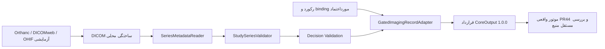

# Imaging Intelligence | Study/Series، دانش پیش‌نویس و اتصال آزمایشی

## مبنا و مالکیت

این تغییر روی `feature/imaging-series-integration` و بر مبنای `feature/imaging-intelligence@502da58b71b174dc70983ac2c7958605259bb726` ساخته شده است. PR۴۵ همچنان مبنای مستقل مرحله اول است. قرارداد موتور یکپارچه‌سازی از PR۴۴ در commit ثابت `abb60d24f79efe498a19faaa9d7bc16967061ef7` خوانده و برای آزمون سازگاری استفاده می‌شود؛ فایل‌های PR۴۳ و PR۴۴ کپی، بازنویسی یا ادغام نمی‌شوند.

## مسیر داده



### Study/Series

`backend/app/imaging_intelligence/series.py` داده فنی مجاز مرحله اول را با ImagePositionPatient، FrameOfReferenceUID توکن‌شده، InstanceNumber و SpacingBetweenSlices ترکیب می‌کند. فایل از یک descriptor محدود خوانده می‌شود؛ raw UID، نام بیمار و مسیر فایل صادر نمی‌شوند. خروجی جدید با نسخه `series-validation-v1` مستقل از `imaging-metadata-v1` است.

- شناسه تکراری یا متعارض، چند Study در یک ورودی، استفاده مجدد از Series UID در Studyهای متفاوت و تفاوت modality/ابعاد/عمق بیت/ناحیه/laterality شناسایی می‌شوند.
- پروفایل حجم کلاسیک CT/MR، Frame of Reference، orientation، pixel spacing و position را بررسی می‌کند. ترتیب از تصویرکردن position روی بردار عمود صفحه به دست می‌آید؛ نام فایل و InstanceNumber جای هندسه را نمی‌گیرند.
- صفحات تکراری، فاصله نامنظم، اختلاف فاصله اعلام‌شده، جابه‌جایی درون‌صفحه‌ای و شکاف شماره‌ها موجب توقف این پروفایل می‌شوند. آستانه‌های عددی صرفاً tolerance نرم‌افزاری هستند، نه معیار کیفیت بالینی.
- حداکثر ۵۱۲ فایل، هر فایل حداکثر ۶۴ MiB است. ورودی empty، خراب، ناقص و چندفریمی بدون هندسه پشتیبانی‌شده به‌صراحت متوقف می‌شود.
- `expected_manifest_matched` فقط برابری مجموعه instanceها با فهرست موردانتظار مورداعتماد را بیان می‌کند. بدون آن، `not_established` باقی می‌ماند؛ حتی فاصله منظم نمی‌تواند کامل‌بودن acquisition را اثبات کند. این برچسب درستی تصویر یا هویت بیمار را ثابت نمی‌کند.

خروجی شامل digest قطعی Study/Series، خطاهای کددار، ترتیب referenceها و provenance موجود است. این مرحله pixels، Enhanced Functional Groups، چند echo/زمان، gantry tilt، همه IODها، کیفیت تشخیصی یا کامل‌بودن بالینی مطالعه را اعتبارسنجی نمی‌کند. برای حجم غیرراست‌گوشه یا سری چندبعدی، پروفایل فعلی abstain می‌کند.

### دانش تصویربرداری

`docs/knowledge/imaging-review-drafts-v1.json` شامل شش پیش‌نویس فنی برای domainهای دقیق `imaging_knee_xray` و `imaging_knee_mri` است: هندسه و فاصله برش، حدود محرمانگی DICOM و دامنه کاربرد RadLex. هر مورد منبع، نسخه/تاریخ دسترسی، پرسش بازبینی و محدودیت دارد. evidence grade برابر `ungraded` است؛ هیچ سطح شواهد بالینی ساخته نشده است.

`prepare_registry_drafts` از **KnowledgeFactCreate واقعی موجود** استفاده می‌کند. خروجی فقط برنامه خشک درخواست ایجاد draft است؛ DB باز نمی‌کند، API نمی‌زند و وضعیت approved، شناسه یا انتساب بررسی را نمی‌پذیرد. تغییر domain به ارتوپدی، تکرار کلید، منابع credentialدار و حذف محدودیت رد می‌شوند. رجیستری و manifest مشترک PR۴۳ مرجع حاکمیت باقی می‌مانند.

متن مستقیم ACR Chronic Knee Pain در زمان بررسی HTTP 403 داد و نتایج جست‌وجو ارجاعات Revised 2018 و Update 2026 را کنار هم نشان دادند. این منبع در صف `needs_full_text_and_version_review` است؛ rating سناریو یا توصیه آن به fact تبدیل نشده است. مرور تخصصی، تعیین نسخه جاری، مجوز استفاده و تأیید مستقل همچنان لازم‌اند. آماده‌کردن draft با تأیید علمی برابر نیست.

### اتصال به PR۴۴

`GatedImagingRecordAdapter` رابط `current_version/collect` سازگار با CoreAdapter موجود دارد. فقط یک Series با فهرست موردانتظار منطبق و کنترل داده موفق را به یک گزارش موجود متصل می‌کند. binding باید شناسه/نسخه/hash گزارش، hash زمینه بالینی و hash Series را از لایه مورداعتماد دریافت کند. تغییر هر کدام، نقص بالینی یا ناسازگاری زمینه باعث `unavailable` می‌شود.

خروجی، `CoreOutput 1.0.0` واقعی و بدون فیلد اضافی است. تنها observationهای همان گزارش و همان source reference عیناً عبور می‌کنند. metadata به observation پزشکی تبدیل نمی‌شود، شناسه گزارش ساخته نمی‌شود و تأیید پزشک ادعا نمی‌شود. نبود observation به معنی `missing` است. `ImagingStudyReference` در موتور PR۴۴ همچنان `modality=unknown` و `dicom_identity_verified=false` دارد؛ lineage DICOM در sidecar می‌ماند و وارد قرارداد سخت‌گیر v1 نمی‌شود.

`imaging_integration_demo` کد **واقعی و جداگانه PR۴۴** را از checkout دارای commit ثابت بارگذاری می‌کند. در نمونه، متادیتای آماده با نبود تأیید منبع همچنان `blocked` می‌ماند؛ فقط با انتساب بررسی کاملاً ساختگی fixture، خلاصه به `awaiting_physician_review` می‌رود. این نه مجوز درمان است و نه ارتقای یافته مدل. این demo، سرویس DB، migration یا API عملیاتی را اجرا نمی‌کند. قواعد Clinical Safety و مسیر Copilot تغییر نکرده‌اند.

### تازگی خروجی ذخیره‌شده

بازبینی بعدی نقصی را بازتولید کرد: Study نامعتبر یا ورودی کنترل بالینی تغییرکرده می‌توانست خروجی جدید را متوقف کند، ولی چون اثرانگشت آداپتر فقط از فایل اتصال ساخته می‌شد، بررسی تازگی PR۴۴ تغییر را نمی‌دید. در نسخه `1.0.1` اثرانگشت مؤلفه به hash کل ارزیابی Study، binding گزارش، نتیجه و قواعد کنترل داده، نسخه pydicom و فایل‌های واقعی reader، validator، DTOها، decision adapter و قرارداد مصرف‌شده وابسته است. زمان اجرا در این اثرانگشت نیست؛ ورودی هم‌ارز نتیجه هم‌ارز دارد.

این مؤلفه یک آداپتر پیکربندی‌شده برای یک binding است؛ hash آن علاوه بر کد، وابستگی‌های sidecar همان binding را مشخص می‌کند. فقط digest وارد `ComponentVersion` می‌شود و قرارداد v1 گسترش نمی‌یابد. در خواندن خروجی ذخیره‌شده، لایه مورداعتماد باید آداپتر را از **وضعیت فعلی** sidecar و binding بسازد؛ نگهداری دائمی نمونه قدیمی در حافظه نمی‌تواند تغییر منبع خارجی را تشخیص دهد. فایل‌های کد باید همراه بسته نصب شوند؛ نبودن manifest باعث توقف می‌شود. بازبینی علمی و احراز هویت منبع همچنان مستقل است.

آزمون `test_imaging_integration_freshness.py` با API و سرویس واقعی PR۴۴ یک خروجی ساختگی ذخیره می‌کند، سپس Study، کنترل بالینی یا binding را تغییر می‌دهد. انتظار: `freshness=stale`، علت `imaging_component_changed`، ثابت‌ماندن snapshot قبلی، پاسخ 409 برای تأیید آن و `blocked` برای اجرای تازه. این آزمون فقط SQLite در حافظه fixtureهای موجود را به کار می‌برد؛ روی شاخه بدون PR۴۴ skip می‌شود و در job ترکیب، اجرای آن الزامی است.

### آزمایشگاه Orthanc، DICOMweb و OHIF

تنظیمات در [`../deploy/imaging-lab`](../deploy/imaging-lab) قرار دارد. imageهای نسخه‌دار `jodogne/orthanc-plugins:1.12.10` و `ohif/app:v3.11.0` استفاده می‌شوند؛ tag نسخه‌دار با digest غیرقابل‌تغییر یا ارزیابی امنیتی همه imageها برابر نیست. Orthanc روی شبکه backend داخلی می‌ماند؛ فقط viewer/proxy برای انتشار پورت‌های loopback به یک bridge لبه متصل است. ذخیره‌سازی موقت و گیرنده DICOM غیرفعال است. OHIF بارگذاری فایل را نمایش نمی‌دهد و proxy viewer فقط خواندن را مجاز می‌کند؛ پورت ۱۸۰۴۲ علاوه بر identity فقط STOW/QIDO/WADO ساختگی را ارائه می‌کند و باقی API مدیریتی مسدود است.

`SyntheticDicomWebLab` فقط به `http://127.0.0.1:18042` وصل می‌شود؛ URL و فایل ورودی نمی‌گیرد. ابتدا Name آزمایشگاه را کنترل می‌کند، سه فایل MR ساختگی خودش را تولید و با STOW-RS ارسال می‌کند، با QIDO-RS مطالعه را می‌خواند و با WADO-RS متادیتا و فایل‌ها را بازیابی می‌کند. پاسخ‌ها محدود، timeoutدار و بدون redirect هستند. شناسه‌ها و markerهای مصنوعی بررسی و خروجی دوباره با validator محلی کنترل می‌شود. این بررسی Name، مرز احراز هویت محیط عملیاتی نیست.

Authentication داخل شبکه آزمایشگاهی غیرفعال است؛ این پیکربندی **فقط برای داده ساختگی محلی** است. تبدیل آن به سامانه مرکز تصویربرداری نیازمند کنترل دسترسی، TLS، رضایت، SSRF، نگهداری و سیاست token مستقل است. هیچ endpoint مرکز یا بیمار برای این فاز پذیرفته نمی‌شود.

### مرز پژوهشی MONAI

`SegmentationEvaluationAdapter` و `MonaiDiceEvaluationAdapter` برای محاسبه Dice روی ماسک‌های باینری کوچک و ساختگی ایجاد شده‌اند. provenance شامل نسخه fixture مدل، hash artifact، hash inventory، ورودی، نسخه MONAI/PyTorch و نتیجه است. پیاده‌سازی واقعی از `monai.metrics.DiceMetric` استفاده می‌کند. ماسک‌ها دستی هستند؛ مدل آموزش‌دیده، inference، وزن مدل، داده بالینی، sensitivity/specificity یا آستانه پذیرش محصول وجود ندارد. ورودی غیرساختگی یا بدون provenance رد می‌شود. نصب این dependencyها اختیاری و جدا از backend عملیاتی است.

## اجرا و آزمون

```bash
python -m pip install -r backend/requirements-imaging-review.txt
python -m unittest discover -s backend/tests/imaging_intelligence -v
python -m backend.tools.imaging_series_demo
python -m backend.tools.imaging_knowledge_drafts
docker compose -f deploy/imaging-lab/compose.yaml up -d
python -m backend.tools.imaging_lab_demo
# OHIF: http://127.0.0.1:18080
docker compose -f deploy/imaging-lab/compose.yaml down --volumes
```

آزمون دوازده مورد اتصال، schema واقعی PR۴۴ را از `MOS_INTEGRATION_CONTRACT_FILE` یا ماژول نصب‌شده می‌گیرد. در محیط بدون این وابستگی، این آزمون‌ها skip می‌شوند؛ CI الزاماً checkout ثابت را فراهم می‌کند. آزمون MONAI در صورت نصب‌نبودن dependency اختیاری skip می‌شود و job جدا آن را با runtime واقعی اجرا می‌کند. «skip» موفقیت آزمون runtime محسوب نمی‌شود.

workflow `imaging-phase2-ci.yml` چهار مسیر دارد: آزمون‌های آفلاین روی Python 3.12/3.14، اجرای موتور واقعی PR۴۴، round-trip واقعی DICOMweb و نمایش frame در OHIF/Chromium، و metric واقعی MONAI روی CPU. این workflow برای PR روی شاخه پایه PR۴۵ و روی main فعال است.

مسیر پنجم، `composition`، دو commit ثابت PR۴۳ و PR۴۴ را فقط در runner دورریختنی روی head این PR ترکیب می‌کند و مجموعه کامل تست‌های backend و مرز تازگی/تأیید را روی Python 3.12/3.14 اجرا می‌کند. checkout فاقد اعتبارنامه نوشتن است؛ هیچ push، merge در GitHub، migration یا اتصال به DB عملیاتی ندارد. شکست ترکیب یا آزمون باید پیش از ادغام واقعی حل شود. مالکیت شاخه‌های دانش و یکپارچه‌سازی تغییر نمی‌کند.

بررسی محلی این بازبینی: **۹۴ مورد، ۹۳ موفق و یک skip مربوط به MONAI** با schema واقعی دریافت‌شده PR۴۴. compileall و بررسی diff موفق بود؛ Compose config و syntax JavaScript در مرحله قبل بررسی شده‌اند. سوکت Docker محیط مدیریت‌شده با `operation not permitted` در دسترس نبود و MONAI/PyTorch نصب نبود؛ اجرای واقعی این دو به CI واگذار شده است. هیچ ادعای اجرای محلی کانتینر یا مدل مطرح نمی‌شود. source رسمی pydicom 3.0.1 مانند مرحله اول خارج از مخزن استفاده شد.

## منابع فنی و حدود استفاده

- [DICOM PS3.3، C.7.6.2](https://dicom.nema.org/medical/dicom/current/output/chtml/part03/sect_C.7.6.2.html): مشخصات position، orientation و فاصله‌های فنی.
- [DICOM PS3.15، E.2](https://dicom.nema.org/medical/dicom/current/output/chtml/part15/sect_E.2.html): مرجع محرمانگی؛ این نرم‌افزار ادعای انطباق کامل با پروفایل ندارد.
- [RSNA RadLex](https://www.rsna.org/practice-tools/data-tools-and-standards/radlex-radiology-lexicon): معرفی واژگان؛ هیچ release یا mapping بارگذاری نشده است.
- [Orthanc DICOMweb](https://orthanc.uclouvain.be/book/plugins/dicomweb.html)، [OHIF Docker](https://v3-docs.ohif.org/3.11/deployment/docker/): پیکربندی سرور آزمایشی و viewer.
- [MONAI metrics](https://docs.monai.io/en/stable/metrics.html)، [PyTorch نسخه‌های قبلی](https://pytorch.org/get-started/previous-versions/): مرجع adapter پژوهشی و نصب CPU نسخه ثابت.

تأیید مستقل علمی، تنظیمات عملیاتی و merge به main در این تغییر انجام نمی‌شوند.
