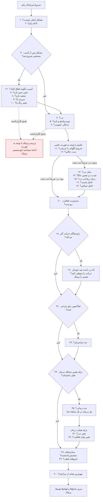
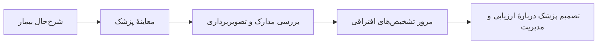

# درخت پیش‌نمایش شرح‌حال زانو

این نسخه، ۳۰ سؤال توافق‌شده در گفت‌وگوی بازبینی را به یک مسیر **تألیف و پیش‌نمایش** تبدیل می‌کند. پذیرش متن و ترتیب سؤال‌ها توسط کاربر، تأیید مستقل پزشکی نیست. همهٔ سؤال‌ها، نگاشت منابع و قواعد انتخاب همچنان **Draft و نیازمند بررسی مستقل متخصص** هستند؛ شمار Approved در این مسیر صفر است.

این قابلیت بانک مصاحبهٔ فعال، پروندهٔ بیمار، Registry یا قواعد عملیاتی ایمنی را تغییر نمی‌دهد. قراردادهای قبلی `OrthopedicQuestionContext`، پیش‌نمایش پایه، پیش‌نمایش کتابی و خروجی مشترک Clinical Integration حفظ می‌شوند. تغییرات این نسخه به یک قرارداد افزایشی و جداگانه محدود است.

## نقشهٔ خوانا برای پزشک

شماره‌ها شناسهٔ ثابت سؤال‌های مورد بازبینی هستند؛ ترتیب نمایش بعضی شاخه‌ها با شمارهٔ سؤال یکسان نیست. هر بیمار فقط وارد شاخه‌های مرتبط می‌شود. پاسخ نامشخص یا متناقض مسیر «خیر» را فعال نمی‌کند.



نمودار یک نمایش ارتباط سؤال‌هاست، نه الگوریتم تشخیص یا تعیین فوریت مستقل. موتور ایمنی موجود همچنان مرجع ارزیابی عملیاتی است. اطلاعات نگران‌کننده برای بررسی پزشک مشخص می‌شوند؛ نبود هشدار یا نبود تب به معنی ایمنی یا رد عفونت نیست. دادهٔ مبهم در هر مرحله برای روشن‌سازی پزشک باقی می‌ماند.

## متن ۳۰ سؤال و شرط نمایش

«همه» در جدول یعنی در دامنهٔ زانو، در صورت ثبت‌نشدن پاسخ قابل‌استفاده؛ نه تکرار پرسش از بیمار دارای پاسخ کامل. گزینهٔ نامعلوم و امتناع از پاسخ باید حفظ شود. متن‌های زیر تألیف کوتاه‌اند و نقل‌قول کتاب یا پرسشنامهٔ اعتبارسنجی‌شده نیستند.

| شماره | متن سؤال | شرط و دامنهٔ منبع |
|---|---|---|
| ۱ | مشکل اصلی زانوی شما چیست؟ | همه؛ G1 |
| ۲ | مشکل مربوط به زانوی راست است یا چپ؟ | همه؛ افزودهٔ طراحی برای تعیین سمت؛ «هر دو» نیز قابل‌ثبت است |
| ۳ | آیا این مشکل پس از یک آسیب مشخص شروع شد؟ | همه؛ G3 در دامنهٔ آسیب حاد |
| ۴ | آیا همراه مشکل زانو تب داشته‌اید؟ | همه؛ G2 |
| ۵ | آیا زانو به‌تازگی به‌طور واضح متورم شده است؟ | همه؛ G2 |
| ۶ | آیا همراه مشکل زانو احساس بدحالی عمومی دارید؟ | همه؛ G2 |
| ۷ | آیا پس از آسیب، بی‌حسی یا تغییر حس تازه‌ای در پای همان سمت پیدا کرده‌اید؟ | فقط سابقهٔ آسیب با پاسخ کامل بله؛ G4 |
| ۸ | آیا پس از آسیب، ضعف تازه‌ای در پای همان سمت پیدا کرده‌اید؟ | همان شرط؛ G4 |
| ۹ | آیا پس از آسیب، پای همان سمت سرد شده است؟ | همان شرط؛ G4 |
| ۱۰ | آیا پس از آسیب، رنگ پای همان سمت تغییر کرده است؟ | همان شرط؛ G4 |
| ۱۱ | شروع علائم ناگهانی بود یا تدریجی؟ | همه؛ G1 |
| ۱۲ | از شروع علائم چقدر گذشته است؟ | همه؛ G1 |
| ۱۳ | درد را بیشتر در کدام قسمت زانو احساس می‌کنید؟ | وجود درد صریحاً ثبت شده باشد؛ G1 |
| ۱۴ | شدت درد زانو همین حالا از صفر تا ده چقدر است؟ صفر یعنی بدون درد و ده یعنی شدیدترین درد قابل‌تصور. | همان شرط؛ G1؛ B1 فقط در زمینهٔ بازبینی آرتروپلاستی؛ زمان «همین حالا» انتخاب طراحی این نسخه است |
| ۱۵ | درد بیشتر در چه زمانی رخ می‌دهد؟ | وجود درد صریحاً ثبت شده باشد؛ G1 |
| ۱۶ | کدام فعالیت بیشتر علائم زانو را تشدید می‌کند؟ | همان شرط؛ G1 |
| ۱۷ | چه چیزی علائم زانو را کاهش می‌دهد؟ | همان شرط؛ G1 |
| ۱۸ | آیا زانو هنگام حرکت گیر می‌کند، به‌طوری‌که نتوانید حرکت را ادامه دهید؟ | همه؛ G3 در دامنهٔ مرتبط |
| ۱۹ | هنگام آن اتفاق، آیا درد باعث شد خودتان حرکت را متوقف کنید؟ | پاسخ کامل بله به ۱۸؛ پیگیری تألیفی برای روشن‌سازی، نه تشخیص علت |
| ۲۰ | مشکل زانو تا چه حد فعالیت‌های روزمرهٔ شما را محدود کرده است؟ | همه؛ G1؛ B1 فقط در زمینهٔ بازبینی آرتروپلاستی |
| ۲۱ | آسیب زانو چگونه اتفاق افتاد؟ | پاسخ کامل بله به ۳؛ G3 در دامنهٔ آسیب حاد |
| ۲۲ | آیا قبلاً روی همین زانو جراحی شده‌اید؟ | همه؛ G1 |
| ۲۳ | چه جراحی‌ای روی این زانو انجام شده است؟ | پاسخ کامل بله به ۲۲؛ پیگیری تألیفی؛ شرح بیمار تأیید گزارش جراحی نیست |
| ۲۴ | آیا قبلاً برای همین مشکل زانو درمانی دریافت کرده‌اید؟ | همه؛ G1 |
| ۲۵ | چه درمانی دریافت کرده‌اید؟ | پاسخ کامل بله به ۲۴؛ هر سابقهٔ درمان جداگانه |
| ۲۶ | پس از آن درمان، درد شما کمتر شد، تغییری نکرد یا بیشتر شد؟ | پس از مشخص‌شدن همان سابقهٔ درمان؛ «نمی‌دانم» قابل‌ثبت است |
| ۲۷ | پس از آن درمان، توان انجام فعالیت‌های روزمره بهتر شد، تغییری نکرد یا بدتر شد؟ | همان شرط؛ پاسخ مستقل از تغییر درد |
| ۲۸ | چه بیماری‌هایی دارید که قبلاً پزشک تشخیص داده باشد؟ | همه؛ G1؛ B2 فقط در زمینهٔ بازبینی پیش از آرتروپلاستی |
| ۲۹ | در حال حاضر چه داروهایی مصرف می‌کنید؟ | همه؛ G1؛ تشخیص اهمیت دارو با پزشک است |
| ۳۰ | مهم‌ترین هدف شما از مراجعه برای مشکل زانو چیست؟ | همه؛ G1 |

فهرست موجود ۲۲ سؤال داشت. این نسخه سؤال عصبی‌عروقی را به چهار سؤال مستقل تبدیل می‌کند؛ پاسخ عمومی به درمان را به درد و عملکرد تفکیک می‌کند؛ سؤال سمت و پیگیری‌های گیرکردن، نوع جراحی و نوع درمان را می‌افزاید. شکل پاسخ بیماری‌های همراه و داروها نیز به‌جای درخواست قضاوت دربارهٔ «مرتبط‌بودن»، گزارش بیمار را دریافت می‌کند.

## قواعدی که باید هنگام بازبینی حفظ شوند

- وجود یا نبود درد باید صریحاً ثبت شود. انتخاب شکایت اصلی «تورم» یا «گیرکردن» نبود هم‌زمان درد را ثابت نمی‌کند. اگر این پیش‌نیاز معلوم نیست، شاخهٔ درد از روی حدس باز یا بسته نمی‌شود.
- مقدار صفر درد و پاسخ false معتبر، پاسخ ثبت‌شده‌اند و نباید سؤال تکراری بسازند. «نامعلوم» و «امتناع» نیز خودکار دوباره پرسیده نمی‌شوند.
- پاسخ ناقص، متناقض یا تأییدنشده به‌جای آخرین‌نویسی، همراه منشأ نگه داشته می‌شود و برای روشن‌سازی پزشک مشخص می‌گردد. این داده‌ها از مجموعهٔ پاسخ‌های قابل‌استفاده کنار گذاشته می‌شوند؛ صرف افزودن یک پرچم بازبینی برای معتبر شمردن آن‌ها کافی نیست. پاسخ نامطمئن والد، شاخهٔ فرزند را فعال نمی‌کند.
- ناسازگاری میان فیلدهای مرتبط نیز بررسی می‌شود: اگر پاسخ صریح والد و دادهٔ وابسته با هم ناسازگار باشند، دادهٔ اصلی حفظ می‌شود اما پاسخ‌های درگیر تا روشن‌سازی پزشک در حالت قرنطینه می‌مانند و شاخه‌ای را فعال نمی‌کنند. این کنترل سازگاری داده است؛ تشخیص پزشکی یا حل خودکار تناقض نیست.
- این کنترل به وابستگی‌های صریح درخت محدود است؛ برای نمونه `has_pain=false` همراه شدت درد ۸، یا نبود جراحی قبلی همراه شرح جراحی، پاسخ‌های درگیر را متناقض می‌کند. اگر والد غایب یا نامطمئن باشد، پاسخ وابسته تا روشن‌شدن پیش‌نیاز ناقص می‌ماند. صرف ثبت مقدار منفی `false`، صفر یا `none` زیر والد منفی، تناقض تازه‌ای ایجاد نمی‌کند و از متن آزاد نیز رابطهٔ جدیدی استنباط نمی‌شود.
- مقدار `laterality="both"` فقط گزارش درگیری هر دو زانو را حفظ می‌کند. پاسخ‌ها، سوابق درمان و یافته‌ها در این نسخه کلید جداگانهٔ سمت ندارند؛ بنابراین یک نمرهٔ درد، سابقهٔ جراحی یا یافتهٔ عمومی را نمی‌توان مستقل به هر دو زانو نسبت داد. برای بررسی جزئیات هر زانو باید **دو زمینهٔ جدا، یکی با `right` و دیگری با `left`** تهیه شود. در حالت `both` این محدودیت برای بازبینی پزشک مشخص می‌شود؛ درگیری دوطرفه به معنی همسان‌بودن علائم یا یافته‌های دو سمت نیست.
- شناسهٔ هر سابقهٔ درمان، پاسخ‌های ۲۵ تا ۲۷ را به همان سابقه پیوند می‌دهد. بهبود درد پس از یک مداخله و بدترشدن عملکرد پس از مداخله‌ای دیگر در یک نتیجه ادغام نمی‌شوند. شرح درمان از متن آزاد به PRP یا روش دیگر طبقه‌بندی خودکار نمی‌شود.
- سؤال شدت درد این نسخه دربارهٔ **همین حالا** است؛ درد فعلی، درد متوسط هفتهٔ قبل یا درد پیش از درمان به هم تبدیل نمی‌شوند.
- شرح نوع جراحی، درمان، بیماری و دارو گزارش بیمار است. هیچ‌کدام به یافتهٔ معاینه، تصویربرداری تأییدشده یا برنامهٔ درمانی پزشک ارتقا نمی‌یابد. متن آزاد برای فعال‌کردن شاخه‌ها تفسیر نمی‌شود.
- از بهبود درد، عملکرد یا تغییر تصویر، بازسازی غضروف، برتری درمان یا اثر علّی مداخله نتیجه‌گیری نمی‌شود. خروجی احتمال تشخیص، تشخیص قطعی، امتیاز اثربخشی، دستور تصویربرداری یا پروتکل درمان ایجاد نمی‌کند.
- این پیش‌نمایش دادهٔ هویتی لازم ندارد؛ نام، شناسهٔ بیمار، تاریخ تولد و جمعیت‌شناسی غیرضروری بخشی از قرارداد آن نیستند. نمونه‌ها و آزمون‌های این مرحله فقط از دادهٔ ساختگی استفاده می‌کنند.

## مسیر جداگانهٔ پزشک



مک‌موری، درجهٔ Kellgren–Lawrence، محل و درجهٔ ساختاری ضایعهٔ غضروفی، بلوغ اسکلتی، ناحیهٔ خون‌رسانی پارگی منیسک، مشخصات تأییدشدهٔ فرآورده و روش تزریق، و برنامهٔ درمانی پزشک سؤال تشخیصی از بیمار نیستند. محل درد، محل ساختاری ضایعه نیست؛ شدت رادیوگرافی نیز جای شدت علائم و محدودیت عملکرد را نمی‌گیرد.

## منابع واقعی و حدود اتصال آن‌ها

| کد | منبع | دامنه و محدودیت |
|---|---|---|
| G1 | ACR/Arthritis Foundation، راهنمای OA سال ۲۰۱۹، منتشرشده در ۲۰۲۰؛ DOI [10.1002/acr.24131](https://doi.org/10.1002/acr.24131)، و [ICRS Evaluation Package، نسخهٔ ۲۰۰۰](https://cartilage.org/wp-content/uploads/2024/07/ICRS_evaluation1-1.pdf) | منابع زمینه‌ای بانک پایه؛ عبارت دقیق سؤال‌ها تألیف است. راهنمای OA، تشخیص OA برای هر مراجعه‌کننده را ثابت نمی‌کند. سال مسیر بارگذاری ICRS، نسخهٔ جدید سند نیست. |
| G2 | SANJO 2023؛ DOI [10.5194/jbji-8-29-2023](https://doi.org/10.5194/jbji-8-29-2023) | اطلاعات مربوط به بررسی عفونت مفصل؛ نبود تب عفونت را رد نمی‌کند. |
| G3 | [AAOS Management of Acute Isolated Meniscal Pathology، ۲۰۲۴](https://www.aaos.org/globalassets/quality-and-practice-resources/acute-meniscal-pathology/amp-cpg.pdf) | دامنهٔ راهنما آسیب حاد و منفرد منیسک است؛ به ضایعات دژنراتیو یا آسیب‌های همراه تعمیم خودکار داده نمی‌شود. |
| G4 | [BOASt: Diagnosis and management of arterial injuries associated with musculoskeletal trauma، ۲۰۲۶](https://www.boa.ac.uk/resource/diagnosis-and-management-of-arterial-injuries-associated-with-musculoskeletal-trauma.html) | گزارش علائم پس از آسیب نیازمند بررسی پزشک است؛ پاسخ بیمار تشخیص عروقی یا معاینهٔ عصبی‌عروقی محسوب نمی‌شود. |
| B1 | *Basics in Primary Knee Arthroplasty*، Springer، ۲۰۲۲؛ فصل ۸، *The Optimal Indication for Total Knee Arthroplasty*؛ DOI [10.1007/978-3-030-58178-7_8](https://doi.org/10.1007/978-3-030-58178-7_8) | PDF 118، صفحهٔ چاپیِ متنی 107؛ درد و عملکرد مستقل از شدت رادیوگرافی، در زمینهٔ بازبینی آرتروپلاستی. این ارجاع آستانهٔ جراحی یا اندیکاسیون برای بیمار تعیین نمی‌کند. |
| B2 | همان کتاب؛ فصل ۱۰، *Patients’ Evaluation Prior to Knee Arthroplasty*؛ DOI [10.1007/978-3-030-58178-7_10](https://doi.org/10.1007/978-3-030-58178-7_10) | PDF 134، صفحهٔ چاپیِ متنی 125؛ بیماری‌های همراه در شرح‌حال پیش از آرتروپلاستی. امتیاز خطر و آزمایش الزامی ایجاد نمی‌کند. |

از کتاب‌ها، فقط **۳۷ صفحهٔ منتخب و مجاور** بررسی متنی شده‌اند: ۱۲ صفحه از *Basics in Primary Knee Arthroplasty*، ۱۰ صفحه از فصل ۴۵ *Campbell’s Operative Orthopaedics* و ۱۵ صفحه از *Orthobiologics*. متن کامل کتاب‌ها در این مرحله خوانده نشده و تأیید بصری PDF انجام نشده است. شمارهٔ چاپی B1 و B2 از سربرگ متن استخراج‌شده بررسی شده است. جزئیات منشأ و محدودیت‌ها در [مکمل کتابی زانو](KNEE_BOOK_REVIEW_FA.md) ثبت شده‌اند.

اتصال مستقیم کتابیِ فعلی فقط شدت درد، عملکرد و بیماری‌های همراه را در زمینهٔ صریح بازبینی آرتروپلاستی پشتیبانی می‌کند. سایر مفاهیم Campbell و Orthobiologics در مسیر موضوع‌های بازبینی پزشک می‌مانند. هیچ‌یک از این منابع یک پرسشنامهٔ ۲۲ یا ۳۰ سؤالیِ استخراج‌شده و اعتبارسنجی‌شده برای این پروژه نیستند. تفکیک درد و عملکرد پس از درمان، انتخاب طراحی برای جلوگیری از اختلاط پیامدهاست؛ از آن شواهد اثربخشی یا بازسازی غضروف ساخته نمی‌شود.

## قرارداد و API پیش‌نمایش

فایل‌های این مسیر:

- [Schema درخت و ورودی پیش‌نمایش](../backend/app/schemas/orthopedic_interview_tree.py)
- [تألیف درخت و انتخاب نامزد سؤال](../backend/app/services/orthopedic_interview_tree.py)
- [سناریوهای ساختگی](examples/orthopedic-interview-tree-cases-v1.json)
- [اجرای نمونهٔ محلی](../backend/tools/orthopedic_interview_tree_demo.py)
- [آزمون‌ها](../backend/tests/test_orthopedic_interview_tree.py)

شناسهٔ درخت `4b-mos.knee-interview-tree` و شناسهٔ خروجی پیش‌نمایش `4b-mos.knee-interview-tree-preview` است؛ نسخهٔ هر دو `1.0.0` است. زمینهٔ جدید `TreeInterviewContext` از زمینهٔ قبلی جداست. `observations` فقط گزارش بیمار را می‌پذیرد؛ `clinical_findings` یافته‌های معاینه و تصویر را در کانال و منشأ قبلی نگه می‌دارد. `confirmed` در این API فقط کامل‌بودن پاسخ ساختاریافته از منشأ اعلام‌شده است و تأیید مستقل واقعیت بالینی نیست.

مسیرهای جدید:

```text
GET /api/v1/knowledge/orthopedics/knee/interview-tree
POST /api/v1/knowledge/orthopedics/knee/interview-tree/preview
```

همان پرچم موجود `ORTHOPEDIC_PREVIEW_ENABLED` باید صریحاً فعال باشد؛ پیش‌فرض غیرفعال است. کنترل نقش `admin` یا `physician` و سرآیند `Cache-Control: no-store` اعمال می‌شود. فعال‌شدن پیش‌نمایش، تأیید محتوا یا مجوز استفادهٔ بالینی نیست.

نمونهٔ درخواست کاملاً ساختگی:

```json
{
  "context": {
    "body_region": "knee",
    "observations": [
      {
        "field": "has_pain",
        "state": "confirmed",
        "value": true,
        "provenance": "patient_report",
        "source_ref": "synthetic:intake"
      },
      {
        "field": "trauma",
        "state": "confirmed",
        "value": false,
        "provenance": "patient_report",
        "source_ref": "synthetic:intake"
      }
    ]
  },
  "review_scopes": ["arthroplasty_review"]
}
```

`has_pain` پیش‌نیاز صریح مسیریابی است و سؤال شمارهٔ ۳۱ ایجاد نمی‌کند؛ از روی انتخاب شکایت اصلی یا متن آزاد حدس زده نمی‌شود. در این نمونه شاخهٔ درد قابل‌طرح است، سؤال آسیب تکرار نمی‌شود و سؤال‌های وابسته به آسیب ایجاد نمی‌شوند. `review_scopes` انتخاب زمینهٔ بازبینی پزشک است؛ تشخیص، اندیکاسیون جراحی یا انطباق بیمار با جمعیت کتاب را ثابت نمی‌کند.

ثبت `both` در یک زمینه جای دو شرح‌حال سمت‌دار را نمی‌گیرد. تفکیک سمت باید در ورودی‌های جدا انجام شود؛ این API از متن جراحی، درمان یا یافتهٔ تصویری، سمت را استخراج و به زمینه‌ها تخصیص نمی‌دهد.

در `treatment_episodes`، هر `episode_ref` یک شناسهٔ غیرهویتی و صریح برای یک سابقهٔ درمان است. توصیف و پاسخ درد و عملکرد همان سابقه زیر `observations` آن ثبت می‌شوند؛ قراردادن این پاسخ‌ها در `context.observations` عمومی مجاز نیست. سابقهٔ درمان مثبت بدون سابقهٔ مشخص، سؤال ۲۵ را پیشنهاد می‌کند و پاسخ‌های ۲۶ و ۲۷ را به درمان نامعلوم متصل نمی‌کند.

خروجی همهٔ نامزدهای قابل‌طرح و موارد نیازمند روشن‌سازی را نشان می‌دهد؛ این نسخه جلسهٔ مصاحبه را اجرا نمی‌کند و به‌تنهایی «سؤال بعدی واحد» یا فوریت بیمار را تعیین نمی‌کند. درخت، زمینهٔ حفظ‌شده، نامزدها، ابهام‌ها، ارجاع‌های استفاده‌شده، دلایل بازبینی و هش‌های درخواست، قواعد و نتیجه قابل‌بررسی‌اند. هش‌ها تغییر بایت‌ها و نسخه را آشکار می‌کنند؛ امضا یا تأیید پزشکی نیستند.

**`tree.bank` فقط خروجی تألیف برای ساختار بانک موجود است، نه درخت قابل‌اجرای مصاحبه.** شرایط تکمیلی `has_pain` و دامنهٔ هر سابقهٔ درمان در قرارداد قدیمی `BankContent` کامل بیان نمی‌شوند. بنابراین نباید این بانک را به‌تنهایی به مصاحبهٔ فعال وارد یا اجرا کرد. مقادیر `bank_export_purpose="authoring_only"` و `bank_export_is_executable_tree=false` این محدودیت را صریح می‌کنند؛ شرایط `nodes` و پیش‌نمایش باید همراه آن بررسی شوند.

## اجرای نمونهٔ ساختگی محلی

از ریشهٔ مخزن، با Python محیط آمادهٔ پروژه:

```bash
python -B -m backend.tools.orthopedic_interview_tree_demo
python -B -m pytest backend/tests/test_orthopedic_interview_tree.py -q
```

demo ده سناریوی ثابت را از فایل نمونه می‌خواند، انتظارهای ساختاریافته را بررسی و خلاصهٔ JSON چاپ می‌کند. اجرای پیش‌فرض فایل خروجی ایجاد نمی‌کند و به دیتابیس یا شبکه متصل نمی‌شود. خلاصه، متن پاسخ‌های آزاد را چاپ نمی‌کند. سناریوها شامل درد تدریجی، آسیب ورزشی، والد نامعلوم یا امتناع، پاسخ متناقض، اطلاعات هشدار، تصویر تأییدنشده و معاینهٔ متناقض، دو سابقهٔ درمان، موضوع خارج از زانو، صفر و false معتبر، و شکایت تورم بدون حدس دربارهٔ درد هستند.

در سناریوی صفر درد، بیمار درد در دورهٔ مشکل را گزارش کرده اما درد همین حالا صفر است؛ این دو گزاره لزوماً متناقض نیستند. هیچ سناریوی ساختگی شاهد اثربخشی یا اعتبارسنجی بالینی نیست. نتیجهٔ واقعی اجرای تست و CI باید برای هر commit جدا گزارش شود.

## مرز اتصال عملیاتی

این درخت یک مسیر جدا برای پیش‌نمایش تألیف است. حفظ وضعیت Draft، احراز منشأ پاسخ در سامانهٔ واقعی، نگاشت به بانک موجود، نسخه‌بندی و تأیید مستقل باید پیش از استفادهٔ عملیاتی با مسیر Clinical Integration هماهنگ شوند. اجرای تست نرم‌افزار، مجوز استفادهٔ پزشکی یا فعال‌سازی قاعدهٔ ایمنی نیست.
