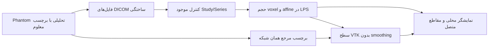

# نمونهٔ بازسازی سه‌بعدی زانوی ساختگی

این مرحله روی `feature/synthetic-knee-3d` با مبنای PR۴۶ در commit `bb185ce4c6cdff3b50f9de00514d308af2ee9702` ساخته شده است. فایل‌های مسیرهای دانش و یکپارچه‌سازی، API، مدل‌های SQLAlchemy، Safety و شاخه main تغییر نمی‌کنند. این یک نمونهٔ مستقل قابل اتصال است؛ در مسیر پرونده واقعی یا Physician Copilot ثبت نمی‌شود.

## نتیجه و محدوده

نمونه از ۶۴ فایل MR یا CT کاملاً تولیدشده، حجم voxel واقعی می‌سازد؛ برچسب‌های مرجع همان phantom را به هشت سطح رنگی تبدیل می‌کند و یک نمایشگر مستقل مرورگر می‌دهد. ساختارها شامل ران، درشت‌نی، کشکک، غضروف، دو منیسک و دو رباط صلیبی هستند. شکل‌ها ساده و تحلیلی‌اند و آناتومی دقیق یک بیمار را نمایش نمی‌دهند. MR و CT از همان مدل ساختگی ساخته می‌شوند؛ الگوریتم registration بین دو اسکن واقعی در این مرحله وجود ندارد.

**این مرحله segmentation خودکار MRI/CT واقعی، تشخیص آسیب یا جایگزین آرتروسکوپی نیست.** رنگ‌ها قراردادی‌اند. «دید داخلی» یک دوربین آزاد در هندسهٔ تولیدشده است؛ حرکت فیزیولوژیک، تماس ابزار، collision، بافت نوری واقعی و جزئیات نادیدهٔ اسکن بازسازی نمی‌شوند. هیچ مدل آموزش‌دیده یا confidence بالینی ساخته نشده است. هش‌ها ردیابی محتوا را ممکن می‌کنند و تضمین صحت بالینی نیستند.



## کد و کنترل هندسه

- `backend/tools/synthetic_knee_fixture.py`: تولید داده تحلیلی و Part 10 ساختگی؛ شدت‌ها فقط برای آزمودن مسیر pixel هستند و شبیه‌ساز فیزیک MRI/CT محسوب نمی‌شوند.
- `backend/app/imaging_intelligence/reconstruction.py`: پروفایل بستهٔ ساختگی با inventory صریح و SHA فایل‌ها. هر فایل از یک descriptor معمولی، بدون دنبال‌کردن symlink و با سقف ۱۲۸ KiB به snapshot بایتی خوانده می‌شود. metadata و pixel از همان snapshot مصرف می‌شوند. کنترل موجود Study/Series دوباره استفاده می‌شود. marker مصنوعی جلوی اشتباه ساده را می‌گیرد؛ اثبات ناشناس‌سازی یا هویت نیست.
- پروفایل فعلی فقط single-frame، Explicit VR Little Endian، MONOCHROME2 شانزده‌بیتی و اندازه حداکثر ۹۶ در هر محور را می‌پذیرد. CT signed و MR unsigned هستند. PixelData باید طول دقیق داشته باشد؛ slope/intercept معتبر روی مقدار واقعی decodeشده اعمال می‌شود. ورودی فشرده یا خارج از پروفایل متوقف می‌شود.
- آرایه `zyx` است. affine چهاردرچهار، مرکز voxel با indexهای `[i,j,k,1]` را به LPS میلی‌متر می‌برد. ضریب i برابر نخستین بردار IOP ضربدر **PixelSpacing[1]** و ضریب j برابر دومین بردار ضربدر **PixelSpacing[0]** است. فاصلهٔ k از position برش‌ها به دست می‌آید؛ SliceThickness جای آن را نمی‌گیرد. نام فایل و ترتیب ورودی دخالتی ندارند.
- `surface_reconstruction.py`: سطح‌های `vtkDiscreteFlyingEdges3D` از برچسب معلوم و با مرز نیم‌voxel ساخته و با همان affine به LPS منتقل می‌شوند. smoothing، resampling یا حدس جزئیات انجام نمی‌شود. مثلث‌های مساحت صفر حذف می‌شوند. حجم گزارش‌شده از شمارش voxel و determinant affine است؛ برآورد بالینی یا حجم محصور mesh نیست.

نام، PatientID، raw UID و مسیر فایل به artifact صادر نمی‌شوند. referenceهای مصدر HMACشده‌اند؛ کلید نمونه ثابت و مخصوص دادهٔ ساختگی است و برای بیمار مناسب نیست. فایل‌های DICOM موقت پس از export حذف می‌شوند؛ artifact فقط شامل داده مشتق‌شده ساختگی است. ورودی arbitrary فایل یا URL، endpoint شبکه و اتصال DB در CLI وجود ندارد. ورود تصویر واقعی به پروفایل بعدی به طراحی دسترسی، حریم خصوصی، پروفایل pixel، segmentation و اعتبارسنجی مستقل نیاز دارد.

## نمایشگر و خروجی قابل دریافت

`backend/imaging_3d_viewer` مدل سطحی رنگی، روشن/خاموش‌کردن هر ساختار، شفافیت استخوان، clipping plane، سه مقطع شبکهٔ حجم، window/level و cursor مشترک دارد. نسبت فیزیکی pixel در مقاطع حفظ می‌شود. کلیک در مقطع، نقطه را با affine در فضای سه‌بعدی مشخص می‌کند. این صفحات، محورهای شبکهٔ حجم‌اند؛ برای ورودی oblique ادعای reslice مستقیم محوری/کرونال بیمار ندارند.

دید داخلی با کشیدن ماوس می‌چرخد؛ `W/A/S/D` حرکت و `R/F` بالا/پایین می‌روند. فقط با focus روی canvas این کلیدها فعال‌اند. این پیمایش، شبیه‌سازی آرتروسکوپی بالینی یا ناوبری ایمن داخل بافت نیست. بازگشت «نمای کامل» دوربین را reset می‌کند.

Three.js نسخه `0.180.0` است. فایل‌های runtime و LICENSE پس از کنترل SHA-256 در برابر commit ثابت `0af9729d0c143a86a1d725d6e2c3ad83301f3f34` داخل artifact کپی می‌شوند؛ CDN، فونت بیرونی و درخواست مرکز تصویربرداری وجود ندارد. voxel و label باینری هنگام بارگذاری در مرورگر با hash و اندازه کنترل می‌شوند. برنامه از WebGL2 استفاده می‌کند و خطای بارگذاری را به‌صورت آشکار نشان می‌دهد.

workflow `Synthetic Knee 3D` برای MR و CT، ZIP جدا شامل `viewer/`، `preview.png` و گزارش آزمون مرورگر در بخش Artifacts همان run نگه می‌دارد (۱۴ روز). پس از دریافت و استخراج، وارد پوشه `viewer` شوید و سرور محلی را اجرا کنید؛ بازکردن مستقیم `file://` به‌دلیل محدودیت module/fetch مرورگر پشتیبانی نمی‌شود.

```bash
# فعلاً محیط اختیاری CPython 3.12؛ dependencyهای عملیاتی تغییر نمی‌کنند.
python -m pip install -r backend/requirements-imaging-3d.txt
npm install --prefix /tmp/4b-knee-node three@0.180.0 --ignore-scripts --no-audit --no-fund
python -m backend.tools.imaging_knee_3d_demo \
  --output /tmp/4b-knee-mr --three-root /tmp/4b-knee-node/node_modules/three --modality MR
python -m http.server 18765 --bind 127.0.0.1 --directory /tmp/4b-knee-mr
# مرورگر: http://127.0.0.1:18765
```

output باید پوشه‌ای جدید باشد. برای CT، output جدید و `--modality CT` انتخاب شود. CLI مسیر DICOM بیمار نمی‌گیرد. برای اجرای artifact دریافت‌شده از CI، نصب Python dependency یا npm لازم نیست؛ فقط سرویس فایل محلی و مرورگر WebGL2 نیاز است.

## آزمون و محدودیت اجرا

```bash
python -m unittest discover -s backend/tests/imaging_3d -v
python -m pip install playwright==1.56.0
python -m playwright install --with-deps chromium
python backend/tests/imaging_3d_browser.py \
  --artifact /tmp/4b-knee-mr --screenshot /tmp/knee-preview.png
```

۱۶ آزمون، MR/CT signed، round-trip همه voxelها، ترتیب فایل، affine oblique و anisotropic، rescale، تفاوت thickness و فاصله برش، فایل خراب، hash تغییرکرده، pixel ناقص، marker نادرست، محدوده فایل، symlink/FIFO، هندسه سطح، topology بسته و عدم خروج اطلاعات هویتی را بررسی می‌کنند. نبود runtime اختیاری در CI عمومی backend باعث skip این ماژول تست می‌شود؛ job اختصاصی 3D پیش از تست import اجباری دارد تا نبود وابستگی را موفقیت محسوب نکند. آزمون MPR در مرورگر یک pixel را با باینری حجم واقعی مقایسه می‌کند؛ صرف نمایش canvas موفقیت محسوب نمی‌شود.

آزمون مرورگر از Chromium و WebGL2 واقعی استفاده می‌کند. Playwright همان فایل‌های artifact را با route محلی ارائه و هر درخواست بیرونی را رد می‌کند؛ سرور DB یا socket شنونده لازم نیست. pixel رنگی واقعی، visibility، opacity، clipping، انتخاب مقطع و نقطه متصل، دوربین داخلی و چیدمان موبایل آزموده می‌شوند. دادهٔ هندسی، decoder و renderer mock نمی‌شوند.

در محیط مدیریت‌شده، نصب شبکه‌ای و راه‌اندازی Chromium با محدودیت sandbox مواجه شد (`setsockopt: Operation not permitted`). اجرای محلی VTK و ۱۶ آزمون هندسه موفق بود؛ ادعای موفقیت مرورگر محلی مطرح نمی‌شود. source رسمی pydicom 3.0.1 و فایل‌های رسمی Three.js خارج از مخزن از طریق دسترسی GitHub دریافت و blob hashهایشان کنترل شدند. اجرای مرورگر و بسته‌بندی artifact در CI انجام می‌شود؛ نتیجه هر run باید با SHA همان PR سنجیده شود.

گام بعد از پذیرش این نمونه، adapter برچسب‌های تصویربرداری با منشأ و شبکهٔ فضایی صریح، اصلاح متخصص و ارزیابی segmentation است؛ مسیرِ ورود دادهٔ بیمار یا مدل تشخیصی در این PR باز نمی‌شود.

## منابع پیاده‌سازی

- [DICOM Image Plane Module](https://dicom.nema.org/medical/dicom/current/output/chtml/part03/sect_C.7.6.2.html): قرارداد position/orientation/spacing.
- [VTK Discrete Flying Edges](https://vtk.org/doc/nightly/html/classvtkDiscreteFlyingEdges3D.html): استخراج سطح از label volume و مرز نیم‌voxel؛ runtime این نمونه به 9.3.1 pin شده است.
- [Three.js r180](https://github.com/mrdoob/three.js/tree/0af9729d0c143a86a1d725d6e2c3ad83301f3f34): renderer و OrbitControls با مجوز MIT.
